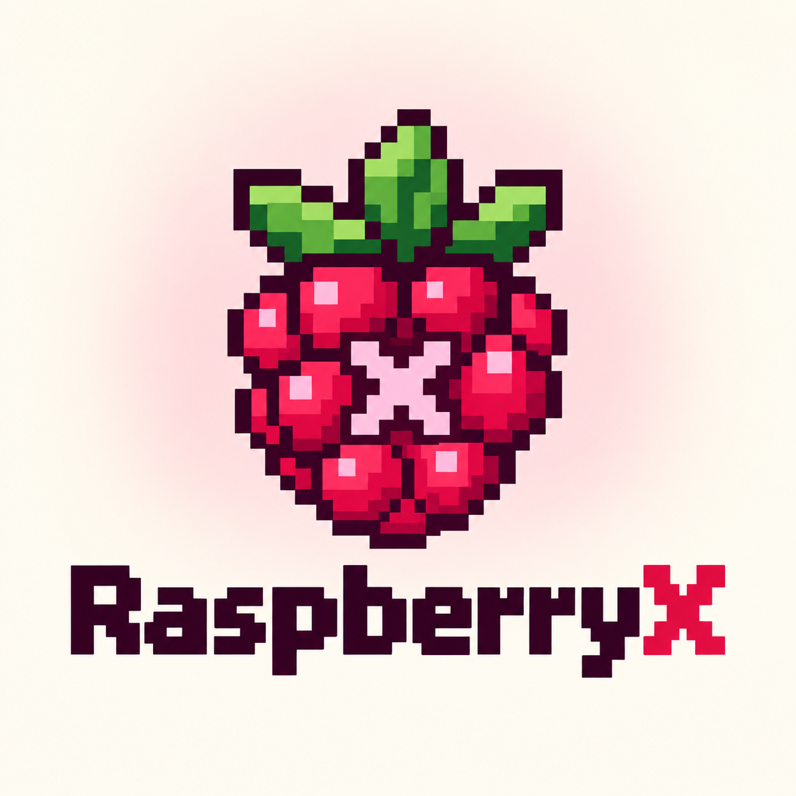

  

  <b>A vanilla-first server for Minecraft: Bedrock Edition, written in PHP Rust and Python.</b>

  
  
  
  
  
  

---

# Introduction:
This software came into life when PocketMine-MP had announced that it will stop updating their services. Over the past months after its closure there were many forks of PocketMine-MP, but they really never solved the issues pocketmine had. Their goal was to optimize a poorly structured software. To each their own, but I want to solve the issues and while doing, so I also want to make it as vanilla as possible so you use this software as dedicated survival world.

**This project is NOT a fork of PocketMine-MP. RaspberryX is written from scratch, and although there are some similarities with class names but the API is different. Plugins from PocketMine-MP will NOT work here. refer to the plugin docs to get started.**

# Description:
Written in PHP, Rust and Python. Each language as a crucial role in this project.

PHP: Mainly for plugin API

Rust: World/chunk, entity and redstone (RaspberryX doesn't use PHP workers instead that's Rust job)

Python: Writing/fetching and generating bedrock data

This project is still in **ALPHA** stages so not every feature is implemented.

# What's inside:
 - Old, pre-normal, void and flat generators
 - Redstone system (partially done)
 - Mobs and their AI (partially done)
 - Player management (Movement, gamemode, exp, hunger, pvp, death ect)
 - Enchantments (Partially done)
 - Effects (90% done)
 - Plugin support (events, plugin-commands, scheduled tasks)

# TODO:
 - [ ] More events
 - [ ] More player mechanics
 - [ ] More entities (Projectiles, Block entities ect)
 - [ ] Refine commands, item/blocks, plugins and worlds.
 - [ ] Add structures
 - [ ] The Nether
 - [ ] The End